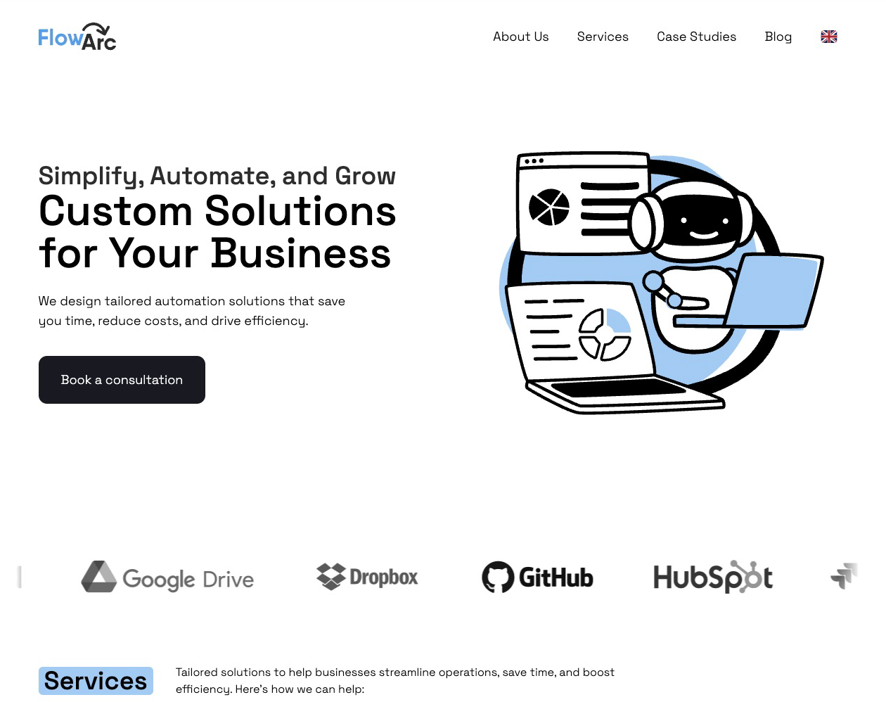
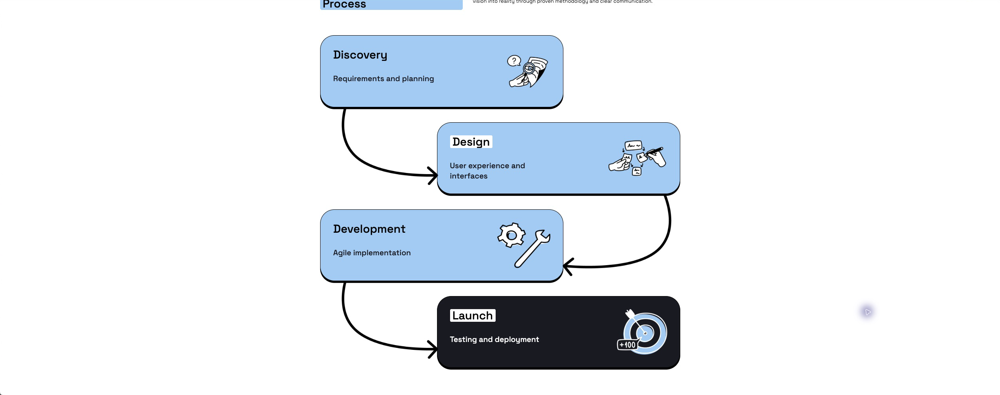
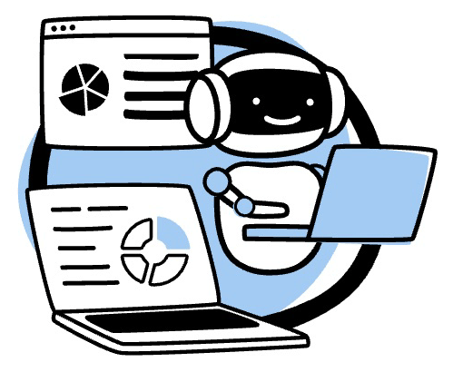
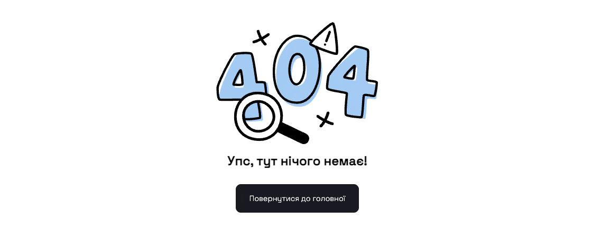

<h1 align="center">FlowArc Studio</h1>

<p align="center">
  The website of a small development studio I co-founded,
  <br />
  designed in Figma and coded by hand before AI tools.
  <br />
  <br />
  <a href="https://flow-arc.vercel.app/en/"><strong>Open the site →</strong></a>
</p>



## The story

### The studio

In November 2022 my partner Ilya and I started an outsourcing studio. For a long time it was called CodeStorm. We tried a few other names after that, and FlowArc was the one we ended up with.

Ilya took care of operations, hiring and clients. I was the technical lead. We were around five people, and most of the developers came to us with little or no experience. I interviewed candidates, taught the ones we took on, and then we found them projects, mostly freelance work through Upwork. I helped them along the way and stepped in when something got hard.

### Why a website

By the end of 2024 we wanted to stop depending on Upwork and find our own clients. Business automation with tools like Make, Zapier and n8n looked like a good direction at the time, because it let you build working solutions for a company quickly. So we decided to offer automation alongside web development, and for that we needed a site. The first commit is from November 28, 2024.

### The design

I designed the site myself in Figma. I started from Positivus, a free landing page template from the Figma Community, and kept reworking it until it felt like ours. I moved it from green to blue, connected the service cards with arrows so the page reads like a flow, and turned the development process into a small diagram.

| The template I started from | Where it ended up |
| --- | --- |
|  |  |

I didn't draw the illustrations from scratch. I found and bought SVGs, then edited them and drew in missing parts so that all of them matched the same loose black outline and the same blue.



The robot in the hero is animated. I learned Rive for this project to make it. The animation is simple, the robot just sways a little while it works.

<p align="center">
  
</p>

The same style goes down to the small things, like the 404 page and the paper plane next to the contact form.



### Building it

I built the site with Astro, React and Tailwind, in English and Ukrainian. Pavlo and Vasyl, two of our developers, built parts of it as part of their training. Pavlo did the blog and the first version of the services page, and Vasyl worked on the styles. Ilya wrote the texts.

The blog and case studies first came from Notion. Notion turned out to be too limited, so in April 2025 I moved them to Sanity, where we planned to write the blog ourselves. The contact form sent messages through Web3Forms, and "Book a consultation" opened Ilya's Calendly.

All of this was written by hand, before I used AI tools for code.

### Where it stopped

The site was finished but never really used, and no client came through it. My last commit is from April 22, 2025.

Part of it was the market, and part of it was that I had found a full-time job. We helped Pavlo and Vasyl find their own clients, they kept working with them, and in August 2025 we closed the studio.

The site is still online, but not all of its copy is true. The About page says the studio was founded in 2020 and has ten people, and the three case studies on the home page are text left over from the template.

## Looking back

I'm proudest of the design. I worked it out on my own, experimenting as I went, and ended up with something that looks fairly unique and has a bit of me in it. The technical part felt more like a chore.

What I'd change is how I worked with people. FlowArc was the first time people worked for me, and sometimes, instead of working with them as a team, I looked down on them a little. I'm a bit ashamed of that now. Teaching Pavlo, Vasyl and the others gave me a lot of practice in explaining things, and I tried to support them and help whenever they got stuck.

## Running it

```bash
bun install
bun run dev
```

The blog and case studies load from Sanity, and the contact form needs a `CONTACT_ACCESS_KEY` from Web3Forms in `.env`.

Built with Astro, React, Tailwind CSS, Motion, Rive and Sanity, deployed on Vercel.
